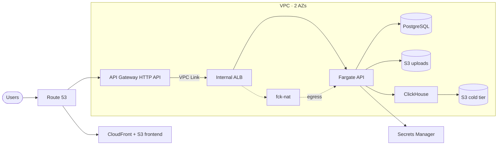
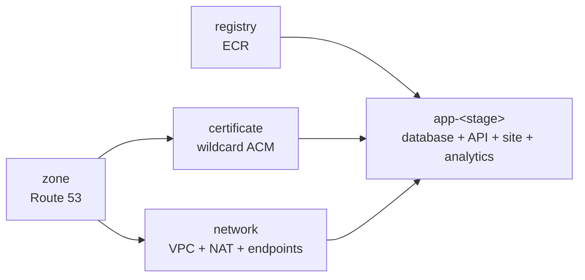

<p align="center">
  
</p>

<h1 align="center">AWS CDK Fullstack Infra</h1>

<p align="center">
  <b>Production-shaped AWS infrastructure for full-stack apps.</b><br/>
  Fargate API · PostgreSQL · S3 + CloudFront · ClickHouse · optional BI — one typed config, zero hardcoded values.
</p>

<div align="center">

  
  
  
  
  

</div>

<br/>

<div align="center">
  
</div>

<p align="center">
  A deployable sample — Node API and React frontend included — with no account IDs, AMIs or secrets baked into the code.
</p>

```bash
cp .env.example .env   # account + domain
npm install && npm run bootstrap
npm run deploy:demo    # infra + API + frontend
```

---

##  What you get

| Layer | Implementation |
| --- | --- |
| Sample app | `examples/api` (Node) and `examples/web` (React + Vite), deployed by one script |
| Frontend | Private S3 bucket behind CloudFront (OAC), SPA routing, cache-aware |
| API | ECR + ECS Fargate behind an **internal** ALB, exposed only through API Gateway + VPC Link |
| Database | PostgreSQL 17 (RDS), generated credentials in Secrets Manager, encrypted storage |
| Analytics | ClickHouse on EC2 with hot/cold S3 storage tiering, internal ALB |
| BI (optional) | Self-hosted Redash via Docker Compose, TLS + CIDR-restricted ALB |
| Network | VPC, 2 AZs, private/public subnets, **fck-nat** instead of a NAT Gateway, optional VPC endpoints |
| DNS / TLS | Route 53 zone + wildcard ACM certificates (delegation-friendly split, CloudFront cert in `us-east-1`) |
| Ops | SSM Session Manager (no SSH, no key pairs), CloudWatch logs, typed stacks + tests |

##  Architecture



Five stacks, deployed in dependency order (zone and certificate live in `us-east-1`):



> `fck-nat` is a tiny EC2 NAT instance — same private-subnet egress, roughly 10× cheaper than NAT Gateway.

##  Quickstart

**Prerequisites:** Node 20+, AWS credentials with admin rights, a domain you control, Docker.

```bash
git clone https://github.com/<you>/aws-cdk-fullstack-infra.git
cd aws-cdk-fullstack-infra
cp .env.example .env      # set CDK_ACCOUNT and ROOT_DOMAIN
npm install
npm run bootstrap         # bootstraps app region + us-east-1
```

**New domain?** Delegate it once, so the certificate can validate:

```bash
npx cdk deploy fullstack-zone    # creates the hosted zone (fast, no certificate)
# copy the NameServers output into your registrar (NS records)
```

Already have a hosted zone? Set `HOSTED_ZONE_ID` in `.env` and skip the step above.

Then deploy the whole sample:

```bash
npm run deploy:demo    # infra + sample API + sample React app
```

`deploy:demo` deploys the registry, pushes `examples/api`, deploys every stack, builds `examples/web` against the API URL and uploads it to S3 + CloudFront.

When it finishes, the outputs are all you need:

| Output | Use |
| --- | --- |
| `ApiUrl` | Public API endpoint (`/health`) |
| `SiteUrl` / `SiteBucketName` / `DistributionId` | Frontend URL and deploy targets |
| `RepositoryUri` | API image repository (scripts read it from `cdk-outputs.<stage>.json`) |
| `ClusterName` / `ServiceName` | Used by `push-image` to roll the service |
| `DatabaseEndpoint`, `DatabaseSecretArn`, `AppSecretArn` | Connection details |

##  Configure

Everything lives in [`config/`](config): environment values in `.env`, defaults and per-stage overrides in [`config/stages.ts`](config/stages.ts).

| Variable | Required | Default | Meaning |
| --- | --- | --- | --- |
| `CDK_ACCOUNT` | yes | — | AWS account that owns the stacks |
| `ROOT_DOMAIN` | yes | — | Apex domain, e.g. `example.com` |
| `CDK_REGION` | no | `eu-west-1` | Region for network and app stacks |
| `HOSTED_ZONE_ID` | no | — | Reuse an existing Route 53 zone |
| `APP_SECRET_ARN` | no | — | Reuse an existing JSON secret |
| `CDK_STAGE` | no | `development` | Or `cdk deploy -c stage=production` |
| `IMAGE_TAG` | no | git sha | Version tag for `push-image` / `deploy:demo` |
| `CERTIFICATE_REGION` | no | `us-east-1` | Certificate bootstrap region; must stay `us-east-1` for CloudFront |

`.env` is read the way dotenv reads it: quoted values keep their content, unquoted values stop at the first ` #` comment. `CDK_ACCOUNT`/`ROOT_DOMAIN` are validated at synth time, and an `api.environment` entry that would shadow a derived variable (`PORT`, `DATABASE_*`, `UPLOADS_BUCKET`, `CLICKHOUSE_PASSWORD`, ...) is rejected instead of silently breaking the container.

Each stage gets its own network, registry and app stack, domains and sizing:

| Stage | API | Frontend | Analytics |
| --- | --- | --- | --- |
| `development` | `api-dev.example.com` | `dev.example.com` | `clickhouse-dev.example.com` |
| `staging` | `api-staging.example.com` | `staging.example.com` | `clickhouse-staging.example.com` |
| `production` | `api.example.com` | `example.com` | `clickhouse.example.com` |

```bash
npm run deploy:staging
npm run deploy:production
```

All subdomains are single-label so one `*.example.com` certificate covers them. Change instance sizes, `retainData`, endpoints or any service setting in `config/stages.ts` — keep values out of the stack code.

The dashboard is off by default. Enabling it requires `dashboard.allowedCidrs` (your office or VPN range): it sits in a private subnet behind an HTTPS ALB, and an empty list is a synth-time error rather than an open console.

##  Develop and validate without deploying

```bash
npm run build && npm test    # strict typecheck + offline stack/config/script tests
npx cdk diff                 # what would change (needs AWS credentials)
cd examples/web && VITE_API_URL=<ApiUrl> npm run dev   # sample frontend, hot reload
```

Everything below runs offline; none of it needs an AWS account.

| Command | What it proves |
| --- | --- |
| `npm run validate` | Typecheck, 30 Jest tests that synthesize every stack and assert on the templates, and a real `cdk.out/` build |
| `npm run lint:cfn` | `cfn-lint` over the synthesized templates — catches deprecated runtimes, invalid instance types and engine versions (needs `python -m pip install --user cfn-lint`) |
| `npm run validate:fakecloud` | Deploys **all five stacks** into fakecloud in Docker: real ECS task, real PostgreSQL, CloudFront/ACM/API Gateway, then probes the running API |
| `bash -n scripts/*.sh` | Shell syntax (the tests do this too, plus run the deploy helpers against temp files) |

### Validate the whole stack with fakecloud

```bash
npm run validate:fakecloud            # bootstrap, push the image, deploy all stacks, verify
npm run validate:fakecloud -- --down  # stop the container and the S3 proxy
```

[fakecloud](https://github.com/faiscadev/fakecloud) (AGPL-3.0, no account, no token) is the only free emulator that covers the whole template: ECS runs the task as a **real Docker container**, RDS is a **real PostgreSQL** container, and ELBv2, CloudFront, ACM (DNS validation auto-issues), API Gateway v2, Route53, ECR, Secrets Manager and CloudFormation are emulated. LocalStack's Community edition went proprietary in March 2026, so the app stack is no longer reachable there.

Two adapters make it work with the CDK CLI, both handled by the script:

- `scripts/s3-path-proxy.js` — CDK publishes assets to `<bucket>.s3.<region>.amazonaws.com` (virtual-hosted) and fakecloud 0.51 only parses path-style requests, so the script points `AWS_ENDPOINT_URL_S3` at a tiny rewrite proxy.
- The CDK CLI caches account IDs per access key; a previous LocalStack run leaves `test -> 000000000000` in `~/.cdk/cache/accounts_partitions.json`, which breaks bootstrap. The stale entry is removed (with a `.bak` backup).

What it proves: the templates deploy through CloudFormation, the image builds and runs, env vars and secrets reach the container (`/health` returns 200 from inside the task), ECS reaches steady state and RDS reports `available`.

What it still cannot prove: EC2 hosts (ClickHouse, Redash) are stubs, so cloud-init never runs; ALB/routing is control-plane only, so the API is probed via `docker exec` rather than through API Gateway; and no real DNS or TLS. Those need one real deployment. For the host scripts, the offline tests at least render every placeholder and assert the generated configuration.

> LocalStack is deliberately not used here any more: its Community edition went proprietary in March 2026, and the frozen image cannot create ECS, RDS, ELBv2, CloudFront or ACM resources — which is the half of this template worth validating locally.

##  Bring your own app

**Backend** — point the script at your Dockerfile. It derives the repository, cluster and service from CDK outputs, pushes a version tag plus `latest`, and rolls the deployment:

```bash
npm run push-image -- ../my-backend 0.6.71   # explicit version
npm run push-image -- ../my-backend          # tag = git sha
```

The service always pulls `latest` from the registry stack, and `push-image` forces a new deployment, so pushing a new image is enough — no CDK deploy. No bucket names, ARNs or account IDs to copy.

**Frontend** — `VITE_API_URL` is baked in at build time (Vite):

```bash
VITE_API_URL=<ApiUrl> npm --prefix examples/web run build
npm run deploy-site -- examples/web/dist     # bucket + distribution from CDK outputs
```

Your container receives:

| Variable | Description |
| --- | --- |
| `PORT`, `API_DOMAIN`, `APP_DOMAIN` | Runtime basics |
| `DATABASE_HOST`, `DATABASE_PORT`, `DATABASE_NAME` | PostgreSQL connection |
| `DATABASE_USERNAME`, `DATABASE_PASSWORD` | Injected from Secrets Manager |
| `UPLOADS_BUCKET` | Private S3 bucket (task role has read/write) |
| `ANALYTICS_URL`, `CLICKHOUSE_PASSWORD` | ClickHouse HTTP endpoint and the generated `default` user password (secret, not plain env) |
| `ENCRYPTION_KEY` (+ your own keys) | From the app secret |

Add extra secret keys with `aws secretsmanager put-secret-value`, then map them to env vars via `api.secrets.env`.

##  Project layout

```
bin/app.ts                  # CDK entry point
lib/app.ts                  # stack assembly, shared with the offline synth
config/                     # the single source of truth
  types.ts                  #   typed configuration surface
  stages.ts                 #   defaults + per-stage overrides
  index.ts                  #   env/.env loader and validation
lib/
  zone-stack.ts             # Route 53 hosted zone (deploy this first)
  certificate-stack.ts      # wildcard ACM certificate in us-east-1
  registry-stack.ts         # ECR repository for the API image
  network-stack.ts          # VPC, fck-nat, VPC endpoints
  application-stack.ts      # wiring of the constructs below
  constructs/               # database, api, static-site, analytics, dashboard
  user-data/                # cloud-init scripts (ClickHouse, Redash)
examples/
  api/                      # sample Node API + Dockerfile
  web/                      # sample React app (Vite)
scripts/                    # deploy-demo, push-image, deploy-site, bootstrap, lib
                            # + synth-offline, cfn-lint, fakecloud
test/                       # stack, config, script and user-data tests
```

##  Teardown

```bash
npm run destroy              # development
npm run destroy:production   # production (sets the stage context)
```

`retainData` is `true` for staging/production: buckets and the database survive `destroy` (deletion protection included). Set it to `false` only when you mean it.

##  Working with AI agents

The repo ships [`AGENTS.md`](AGENTS.md) — a precise playbook for coding agents: invariants, where to change what, and how to start a new project from this bootstrap. Point your agent at it before it touches the stacks.

##  License

[MIT](LICENSE) — use it, fork it, ship it.

<p align="center">
  <sub>Built with  on AWS CDK · MIT</sub>
</p>
